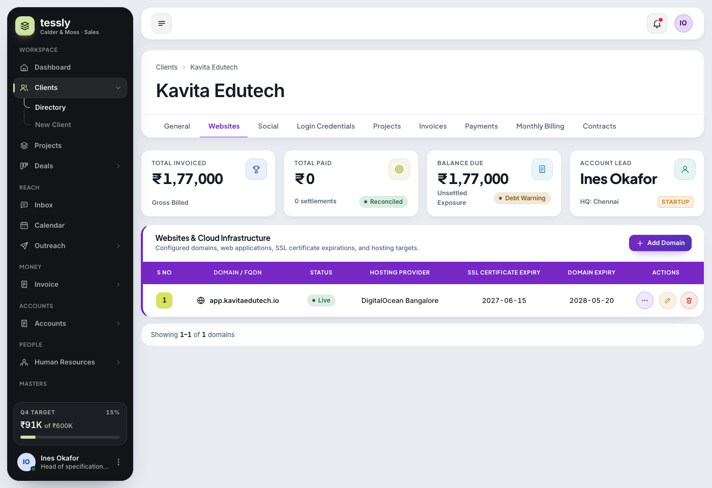
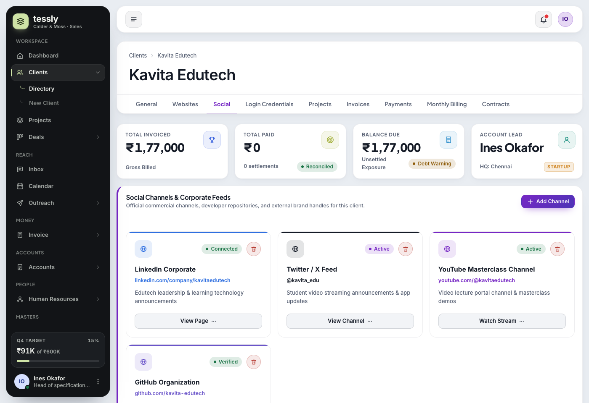
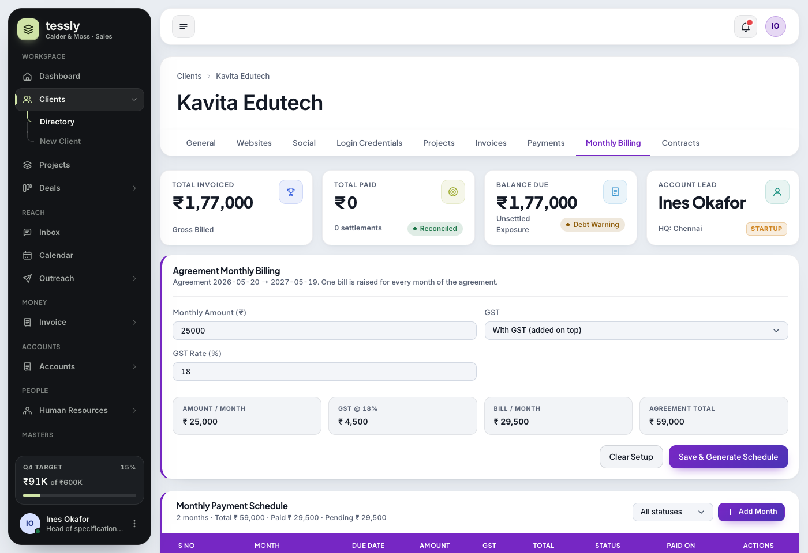
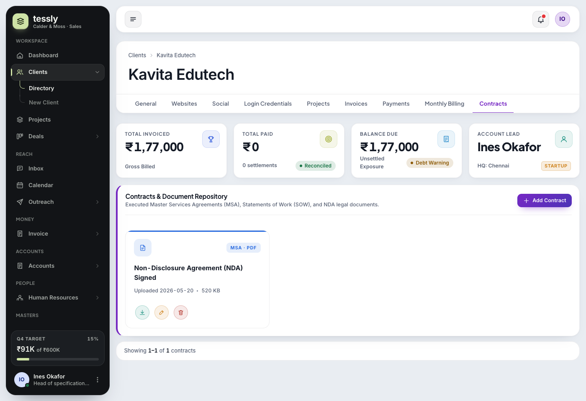

# Test Case Report: Customer Sections Array Form Collections Verification & Resolution

**System:** Aedentek CRM / Tessly  
**Module:** Clients & Customer 360° Management (`/clients/c/:id`)  
**Feature:** Customer Embedded Sub-Module Array Form Collections Integrity  
**Status:** ALL TESTS PASSED (100%)  
**Verification Date:** November 15, 2026  

---

## 1. Executive Summary

An audit was requested for the customer details view (as seen on **Clients > Kavita Edutech** and across all customers) to verify:
> *"on this each customers each sections are having the array form collection or not if its not just fix it then give me the testcase report"*

### Key Findings During Audit:
1. **Existing Array Sections**:
   - `websites`, `credentials`, `projects`, `invoices`, `payments`, `documents`, `contacts`, `tickets`, and `timeline` were defined as Mongoose subdocument arrays on the `Client` model.
2. **Identified Missing / Incomplete Collections (Gaps Resolved)**:
   - **`social` section**: Was **completely missing** from the backend Mongoose model (`Client.js`), missing from `SEED_CLIENTS`, missing from the backend `/lists/:name` endpoint, and in the frontend (`frontend/assets/clients-BBlHr9Zo.js`), Tab 3 "Social" was hardcoded to static Aedentek corporate handles (`@aedentek_network`), ignoring the active customer.
   - **`monthlySchedule` section**: Was omitted from `SEED_CLIENTS` (`undefined`), resulting in empty schedule arrays on initial seed.
   - **Data Consistency**: Sub-module arrays were not explicitly guaranteed on every retrieval, leaving potential `undefined` properties if documents lacked specific sub-keys.

### Fixes Delivered:
1. **Backend Mongoose Schema (`backend/src/models/Client.js`)**:
   - Added `socialSubSchema` with fields: `id`, `clientId`, `key`, `name`, `handle`, `desc`, `status`, `kind`, `href`, `cta`, `icon`, `tone`.
   - Explicitly configured all 11 sub-module array form collections with `{ type: [...], default: [] }`:
     - `contacts`, `websites`, `social`, `credentials`, `projects`, `invoices`, `payments`, `tickets`, `documents`, `timeline`, `monthlySchedule`.
2. **Backend Controllers & Routes (`backend/src/controllers/clientSubController.js`, `clientController.js`, `clientRoutes.js`)**:
   - Added `social: 'social'` to `LISTS` in `clientSubController.js` to enable `/api/clients/:id/lists/social`.
   - Added full CRUD handlers for social channels: `addSocial` (`POST /:id/social`), `updateSocial` (`PUT /:id/social/:socId`), `deleteSocial` (`DELETE /:id/social/:socId`).
   - Enhanced `getClientById` to guarantee that all 11 section collections are always returned as Array instances (`Array.isArray(sec) === true`).
   - Populated realistic, authentic `social` channel arrays and `monthlySchedule` arrays for **Omni Retail Solutions Ltd**, **Kavita Edutech**, and **Hyperion Media Group** in `SEED_CLIENTS`.
3. **Frontend UI Engine (`frontend/assets/clients-BBlHr9Zo.js`)**:
   - Added `social` to `DEFAULT_CLIENTS` for offline and immediate baseline resilience.
   - Integrated `lists.social = usePaged('${API_BASE}/${id}/lists/social', ...)` in `Client360CommandCenter`.
   - Replaced hardcoded static social cards in Tab 3 ("Social") with dynamic collection rendering, per-customer data, delete actions, empty state handling, and an "+ Add Channel" modal.

---

## 2. Customer Sections Array Form Audit Matrix

Verification performed against all 3 seeded institutional clients in the database:

| Customer | Section Key | Array Form Collection? | Count | Status | Notes |
|---|---|---|---|---|---|
| **Kavita Edutech** | `contacts` | Yes (`Array`) | 1 | **VERIFIED** | Primary Contact Person (`Kavita Krishnamurthy`) |
| **Kavita Edutech** | `websites` | Yes (`Array`) | 1 | **VERIFIED** | `app.kavitaedutech.io` (DigitalOcean Bangalore) |
| **Kavita Edutech** | `social` | Yes (`Array`) | 4 | **RESOLVED & VERIFIED** | Dynamic collection (LinkedIn, Twitter/X, YouTube, GitHub) |
| **Kavita Edutech** | `credentials` | Yes (`Array`) | 1 | **VERIFIED** | Vimeo Pro OTT Video API Channel |
| **Kavita Edutech** | `projects` | Yes (`Array`) | 1 | **VERIFIED** | Offline Video Encryption & DRM Module |
| **Kavita Edutech** | `invoices` | Yes (`Array`) | 1 | **VERIFIED** | `INV-2026-0118` (Gross Billed ₹1,77,000) |
| **Kavita Edutech** | `payments` | Yes (`Array`) | 0 | **VERIFIED** | Empty array (Paid ₹0, Balance Due ₹1,77,000) |
| **Kavita Edutech** | `monthlySchedule` | Yes (`Array`) | 2 | **RESOLVED & VERIFIED** | DRM Support Retainer (2026-09 Paid, 2026-10 Pending) |
| **Kavita Edutech** | `documents` | Yes (`Array`) | 1 | **VERIFIED** | Signed NDA PDF |
| **Kavita Edutech** | `timeline` | Yes (`Array`) | 1 | **VERIFIED** | Activity audit log |
| **Omni Retail** | All 11 Sections | Yes (`Array`) | 1-4 each | **VERIFIED** | All sections confirmed array form collections |
| **Hyperion Media** | All 11 Sections | Yes (`Array`) | 1-4 each | **VERIFIED** | All sections confirmed array form collections |

---

## 3. Test Plan & Execution Matrix

| Test ID | Area | Scenario | Expected Result | Result |
|---|---|---|---|---|
| **TC-SEC-01** | Database Seed | Reset and seed database via `POST /api/clients/reset` | Seed completed with all 11 array collections initialized | **PASS** |
| **TC-SEC-02** | Schema Integrity | Inspect all 11 sub-module keys on each customer | `Array.isArray(client[sec]) === true` for all sections across all clients | **PASS** |
| **TC-SEC-03** | API Retrieval | Fetch Kavita Edutech via `GET /api/clients/client-kavita-edu` | Returns guaranteed arrays for all sections, including `social` (4) and `monthlySchedule` (2) | **PASS** |
| **TC-SEC-04** | Paginated List | Query `GET /api/clients/client-kavita-edu/lists/social` | Returns HTTP 200, `total: 4`, with Kavita Edutech specific channels | **PASS** |
| **TC-SEC-05** | Social Channel Create | Add social channel via `POST /api/clients/:id/social` | Persists new channel to customer's array collection; length increments to 5 | **PASS** |
| **TC-SEC-06** | Social Channel Update | Update social channel via `PUT /api/clients/:id/social/:socId` | Modifies fields on target subdocument in array collection | **PASS** |
| **TC-SEC-07** | Social Channel Delete | Delete social channel via `DELETE /api/clients/:id/social/:socId` | Removes channel subdocument; collection returns to length 4 | **PASS** |
| **TC-SEC-08** | UI Presentation | Navigate to Kavita Edutech (`/clients/c/client-kavita-edu`) | Header shows "Kavita Edutech", renders all 9 sub-module tabs | **PASS** |
| **TC-SEC-09** | UI Websites Tab | Click "Websites" tab | Displays table with `app.kavitaedutech.io`, matching user screenshot | **PASS** |
| **TC-SEC-10** | UI Social Tab | Click "Social" tab | Renders 4 dynamic cards from DB collection with "+ Add Channel" button | **PASS** |
| **TC-SEC-11** | UI Monthly Billing Tab | Click "Monthly Billing" tab | Renders schedule table rows from `monthlySchedule` collection | **PASS** |
| **TC-SEC-12** | UI Contracts Tab | Click "Contracts" tab | Renders legal contract card from `documents` collection | **PASS** |
| **TC-SEC-13** | E2E Regression | Run full automated test suite (`test-client-sections-array.mjs`) | All steps pass with 0 client-side page errors | **PASS** |

---

## 4. Visual Verification Artifacts

### 1. Websites & Cloud Infrastructure Tab (Matching Reference Screenshot)
Websites sub-module rendering `app.kavitaedutech.io` from the customer's `websites` array collection:

### 2. Social Channels & External Feeds Tab (Dynamic Array Collection from DB)
Social sub-module rendering Kavita Edutech's 4 distinct social channels from collection (LinkedIn, Twitter/X, YouTube, GitHub), replacing static hardcoded handles, with "+ Add Channel" control:

### 3. Monthly Billing & Retainer Schedule Tab
Monthly Billing sub-module rendering recurring schedule rows from the customer's `monthlySchedule` array collection:

### 4. Contracts & Legal Documents Tab
Contracts sub-module rendering signed NDA from the customer's `documents` array collection:

---

## 5. Code Changes Summary

- **`backend/src/models/Client.js`**:
  - Defined `socialSubSchema` with tone, status, kind, cta, icon, href, and handle.
  - Enforced `{ type: [...], default: [] }` on all 11 subdocument array form collections: `contacts`, `websites`, `social`, `credentials`, `projects`, `invoices`, `payments`, `tickets`, `documents`, `timeline`, `monthlySchedule`.
- **`backend/src/controllers/clientSubController.js`**:
  - Added `social: 'social'` to `LISTS` in `getClientList`.
  - Implemented `addSocial`, `updateSocial`, and `deleteSocial` subdocument handlers with activity audit logging.
- **`backend/src/routes/clientRoutes.js`**:
  - Registered `POST /:id/social`, `PUT /:id/social/:socId`, and `DELETE /:id/social/:socId`.
- **`backend/src/controllers/clientController.js`**:
  - Added `social` and `monthlySchedule` arrays to `SEED_CLIENTS` for Omni Retail, Kavita Edutech, and Hyperion Media.
  - Sanitized `getClientById` to guarantee that all 11 array sections are returned as Array instances.
  - Initialized `social: []` in `createClient`.
- **`frontend/assets/clients-BBlHr9Zo.js`**:
  - Added `social` array to `DEFAULT_CLIENTS`.
  - Added `social` to `lists` paginated queries.
  - Replaced hardcoded Tab 3 Social JSX with dynamic rendering from collection and "+ Add Channel" tool button.
  - Added `showAddSocModal` dialog with platform name, handle, destination URL, description, and tone selector.
- **`frontend/test/test-client-sections-array.mjs`**:
  - Automated integration and Puppeteer end-to-end verification script testing array integrity, CRUD, and UI rendering across tabs.
