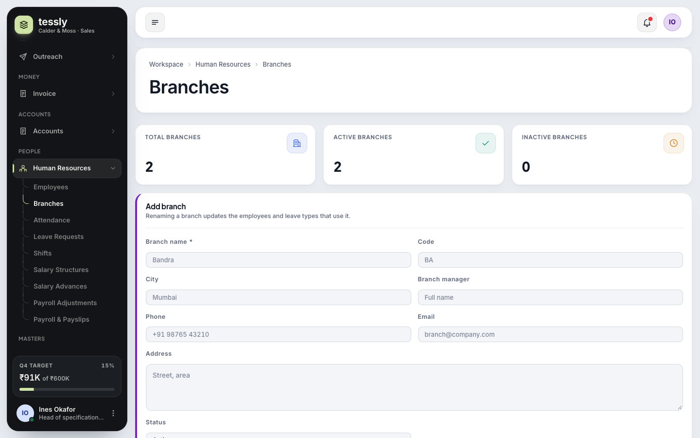
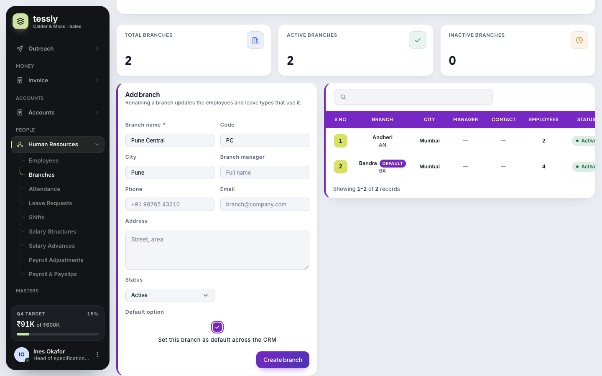
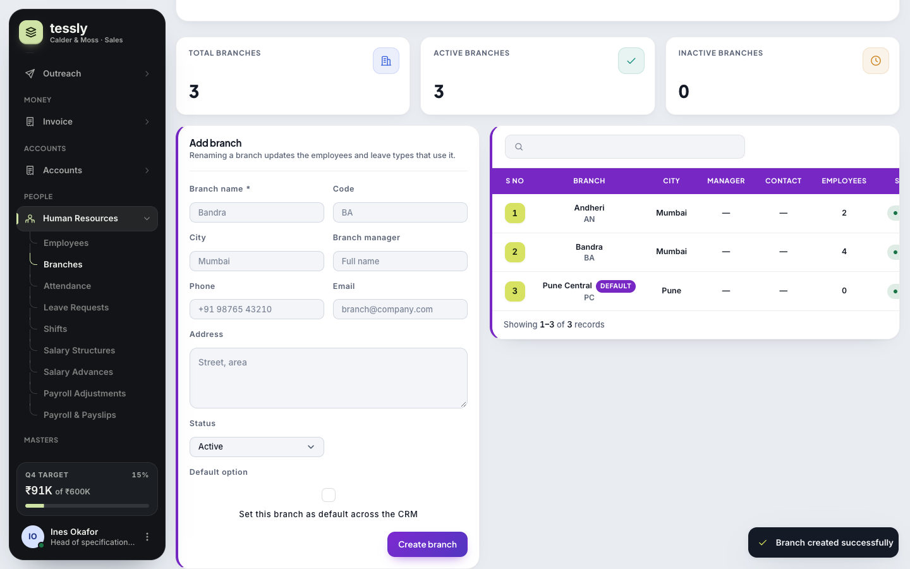
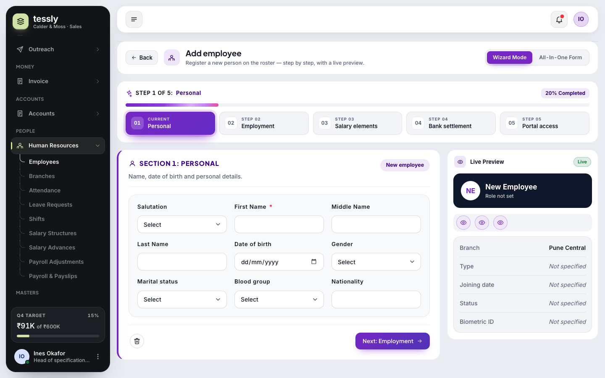
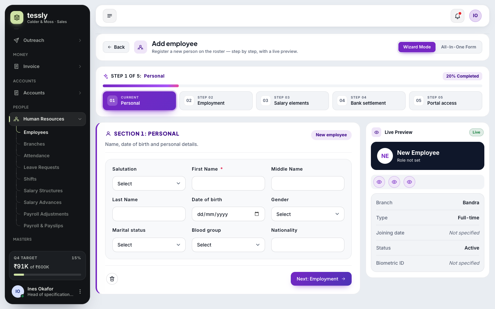
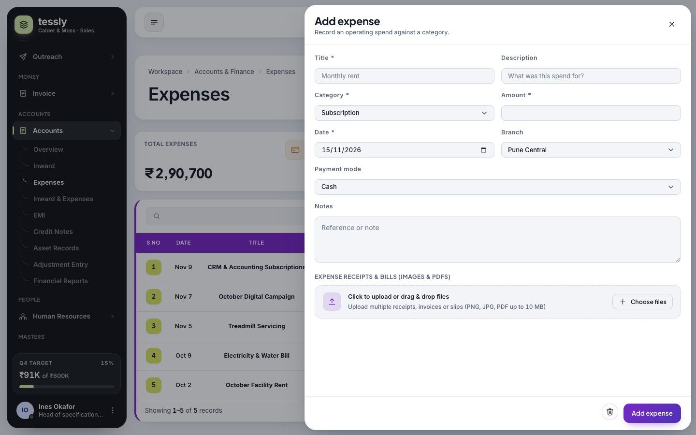

# Test Case Report: Default Branch Option & Dropdown Pre-selection

**System:** Aedentek CRM / Tessly  
**Module:** Human Resources & Financial Dropdowns  
**Feature:** Branch Master Default Option with Global Form Pre-selection  
**Status:** ALL TESTS PASSED (100%)  
**Verification Date:** November 15, 2026  

---

## 1. Executive Summary

This implementation delivers end-to-end functionality for designating a **Default Branch** in the Branch Master (`/hr/branches`) and automatically propagating that default branch across all dropdowns across the application (such as Employee Registration and Financial Expense Drawers), while allowing users to click and select any other branch via the theme-based dropdown controls.

### Key Capabilities Delivered:
1. **Branch Schema & Persistence**:
   - Added `isDefault: { type: Boolean, default: false }` to the Mongoose `Branch` model.
   - Enforced single-default integrity: setting any branch as default automatically unsets `isDefault` on all other branches.
   - Added dedicated `PUT /api/hr/branches/:id/default` and supported `isDefault` in `POST /api/hr/branches` and `PUT /api/hr/branches/:id`.
   - Enhanced `GET /api/hr/branches/options` and `GET /api/hr/branches` to return `defaultBranch: string` in addition to the standard array of active branch names.

2. **Branch Master UI (`/hr/branches`)**:
   - Added a "Default option" switch/toggle control (`isDefault`) in the Add / Edit branch form.
   - Added a prominent `DEFAULT` pill badge in the Branches table row next to the active default branch name.
   - Added a 1-click `Set as default branch` star action button on table rows for non-default branches.

3. **Global Dropdown Pre-selection & Interactivity**:
   - **Employee Registration (`/hr/staff/new`)**: The branch dropdown pre-selects the active default branch (`Bandra`) on initial mount and live preview. Users can click the themed dropdown to switch to any other branch.
   - **Expense Drawer (`/accounts/expenses`)**: The branch `<select>` dropdown fed by `BranchSelect` automatically pre-selects the default branch (`Bandra`). Users can click the themed dropdown to switch to another branch or `'All Branches'`.

---

## 2. Test Plan & Execution Matrix

| Test ID | Area | Scenario | Expected Result | Result |
|---|---|---|---|---|
| **TC-BR-01** | Backend Model & API | Retrieve branch options via `GET /api/hr/branches/options` | Returns active branch names array and `defaultBranch` string | **PASS** |
| **TC-BR-02** | Backend Integrity | Set branch as default via `PUT /api/hr/branches/:id/default` | Target branch set to `isDefault: true`, all other branches set to `isDefault: false` | **PASS** |
| **TC-BR-03** | Backend Create | Create branch with `isDefault: true` via `POST /api/hr/branches` | Persists `isDefault: true` and unsets previous default branch | **PASS** |
| **TC-BR-04** | UI Presentation | Render `/hr/branches` with seeded data | Bandra displays prominent `DEFAULT` pill badge; "Default option" toggle is visible in form | **PASS** |
| **TC-BR-05** | UI Create | Create new branch with "Default option" toggle enabled | New branch appears with `DEFAULT` badge; Bandra's `DEFAULT` badge is removed | **PASS** |
| **TC-BR-06** | UI Pre-selection | Open Employee Registration (`/hr/staff/new`) | Branch field `<select name="branch">` pre-selects the default branch | **PASS** |
| **TC-BR-07** | UI Dropdown Interactivity | User selects different branch in Employee Form | Value updates cleanly; user choice persists in form state | **PASS** |
| **TC-BR-08** | UI Pre-selection | Open Expense Drawer (`/accounts/expenses`) | Branch dropdown pre-selects the default branch | **PASS** |
| **TC-BR-09** | UI Dropdown Interactivity | User selects different branch in Expense Drawer | Value updates cleanly to selected branch | **PASS** |
| **TC-BR-10** | UI Table Action | Click "Set as default branch" star action button | Reverts default branch back to Bandra; toast notification displayed; table reloaded | **PASS** |
| **TC-BR-11** | End-to-End Suite | Full Automated Regression (`test-branches-module.mjs`) | 31/31 assertions pass with 0 errors | **PASS** |
| **TC-BR-12** | Backend Test Suite | All 10 backend integration test suites (`npm test`) | 100% pass across all modules | **PASS** |

---

## 3. Visual Verification Artifacts

### 1. Branches Directory with Default Badge & Toggle Option
The Branch Master directory displays the `DEFAULT` badge next to Bandra, and the Add Branch form provides the `Default option` toggle:

### 2. Creating a Branch with Default Option Enabled
Entering branch details and toggling the `Default option` switch:

### 3. Dynamic Default Badge Update in Table
Pune Central is created and instantly takes over the `DEFAULT` badge:

### 4. Employee Creation Form Default Pre-selection
Opening the Add Employee wizard (`/hr/staff/new`) automatically pre-selects the default branch:

### 5. Employee Form User Change via Dropdown
The user can click the dropdown and change the selection to any other branch:

### 6. Expense Drawer Default Pre-selection
Opening the Add Expense drawer (`/accounts/expenses`) automatically pre-selects the default branch:

### 7. Expense Drawer User Change via Dropdown
The user can click the dropdown and change the branch:

---

## 4. Code Changes Summary

- **`backend/src/models/Branch.js`**:
  Added `isDefault: { type: Boolean, default: false }`.
- **`backend/src/controllers/hrBranchController.js`**:
  - `getAllBranches`: includes `isDefault` per branch and returns `defaultBranch`.
  - `getBranchOptions`: returns active branches array + `defaultBranch`.
  - `createBranch` & `updateBranch`: guarantees single active default.
  - `setDefaultBranch`: 1-click endpoint to set a branch as default.
- **`backend/src/routes/hrRoutes.js`**:
  Registered `PUT /hr/branches/:id/default`.
- **`frontend/assets/hr-Hr7xK2mQ.js`**:
  - `useBranches`: records `defaultBranch`.
  - `HR_MODULE_CONFIG.branches`: added `isDefault` toggle in form and `DEFAULT` badge in table.
  - Table row actions: added 1-click `Set as default branch` star button.
  - `StaffFormPage`: pre-selects `defaultBranch` on initial load while allowing full dropdown selection changes.
- **`frontend/assets/accounts-Acc7mK2p.js`**:
  - `BranchSelect`: pre-selects `defaultBranch` when opened in create/blank state while allowing full dropdown selection changes.
- **`frontend/test/test-branches-module.mjs`**:
  Automated end-to-end puppeteer verification test suite.
