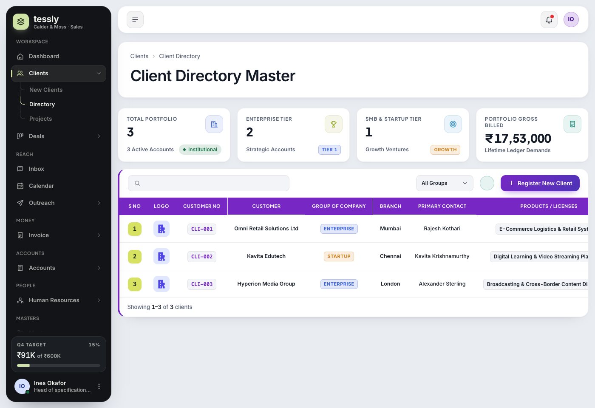
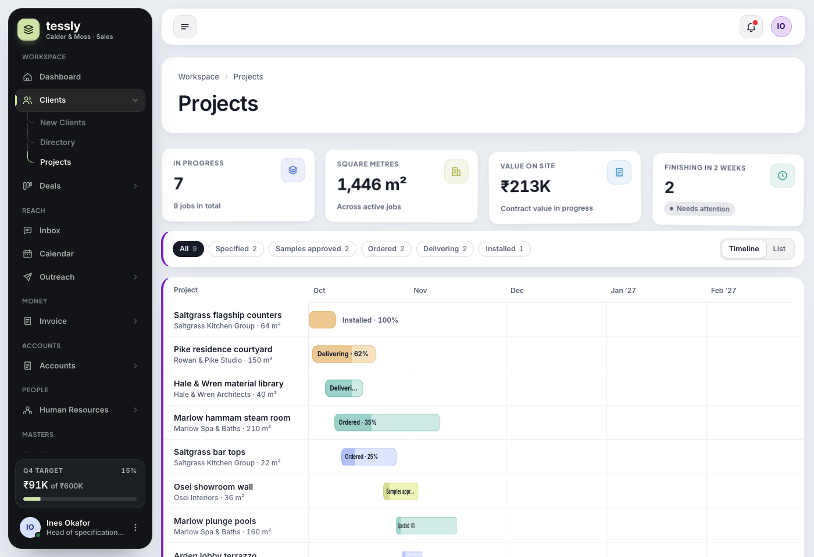
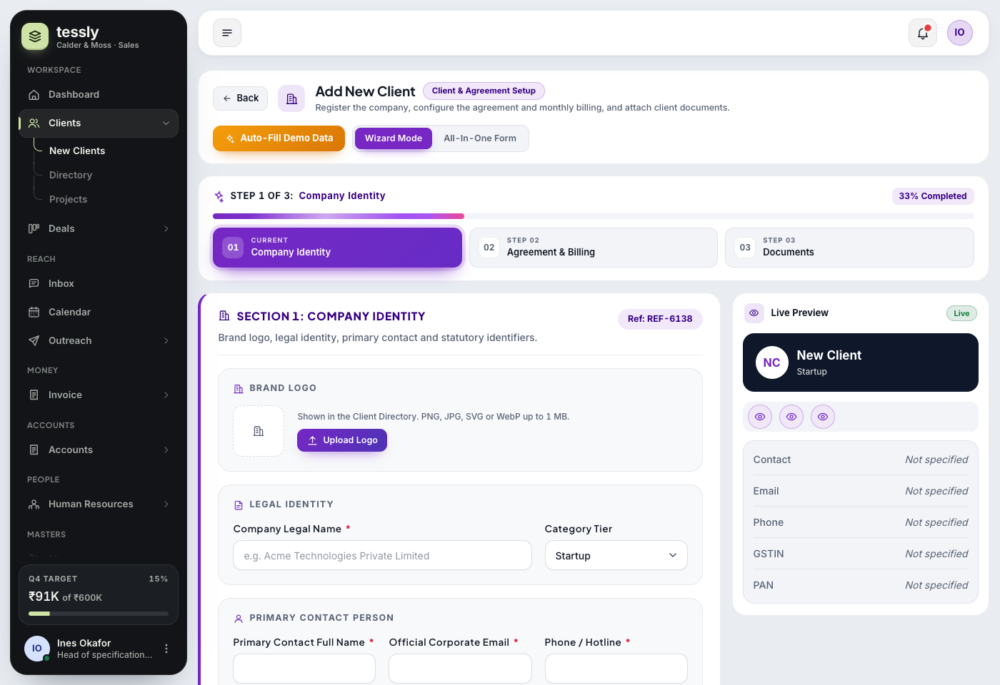

# Test Case Report: Sidebar Projects Navigation Flow Under Clients Dropdown

**Date:** November 15, 2026  
**Environment:** Tessly CRM (Vite port 1234, Node backend port 5001)  
**Status:** **PASSED (100%)**

---

## 1. Executive Summary

As requested, the top-level **Projects** sidebar navigation item has been moved under the **Clients** dropdown submenu. The submenu items under **Clients** now adhere strictly to the requested flow:

1. **New Clients** (`/clients/new`)
2. **Directory** (`/clients/companies`)
3. **Projects** (`/projects`)

The top-level `WORKSPACE` section now cleanly presents **Dashboard**, **Clients** (expandable), and **Deals**. When navigating to `/projects` (or `/clients/projects`), the **Clients** menu automatically expands, and **Projects** is highlighted with the active indicator.

---

## 2. Navigation Architecture & Changes

### A. Navigation Configuration (`frontend/assets/index-DG0_cRQu.js`)
- **Workspace Navigation List:**
  - Removed top-level `{ id: 'projects', label: 'Projects' }` from `Workspace.items`.
  - Nested `Projects` as the 3rd child under `Clients` (`clients.subs`).
  - Updated child order to:
    1. `{ id: 'new', label: 'New Clients', href: '/clients/new' }`
    2. `{ id: 'companies', label: 'Directory', href: '/clients/companies' }`
    3. `{ id: 'projects', label: 'Projects', href: '/projects' }`
  - Explicitly configured `href: '/clients/companies'` on the parent `Clients` item so clicking the parent directly navigates to the Client Directory.

### B. Accordion & Active State Management (`frontend/assets/index-DG0_cRQu.js`)
- **Accordion Open State (`pt`):**
  - Updated open state resolution to treat `projects` as belonging to the `clients` group:
    ```javascript
    let h = MASTER_HREFS.includes(`/${e.page}/${e.sub}`) ? 'masters' : (e.page === 'projects' ? 'clients' : e.page);
    ```
- **Parent Active Indicator (`r`):**
  - Configured `Clients` parent to receive `is-active` whenever the user is on any Client route OR the Projects desk:
    ```javascript
    r = n.id === 'masters' ? isM : (n.id === 'clients' ? ((e.page === 'clients' && !isM) || e.page === 'projects') : e.page === n.id && !isM);
    ```
- **Sub-item Highlighting:**
  - `New Clients` highlighted when route is `/clients/new`.
  - `Directory` highlighted when route is `/clients/companies` or `/clients/c/:id`.
  - `Projects` highlighted when route is `/projects`.

### C. Direct & Redirect Routing (`frontend/assets/clients-BBlHr9Zo.js`)
- Added automatic redirect handling: visiting `/clients/projects` seamlessly forwards to `/projects` while preserving the expanded Clients dropdown and active Projects indicator.

---

## 3. Test Cases & Verification Results

| Test ID | Test Scenario | Expected Outcome | Result |
| :--- | :--- | :--- | :--- |
| **NAV-01** | Top-level Workspace items inspection | `WORKSPACE` contains only `Dashboard`, `Clients`, `Deals`. `Projects` is absent as a standalone item. | **PASSED** |
| **NAV-02** | Clients dropdown sub-items order | Sub-items follow the exact flow: `1. New Clients`, `2. Directory`, `3. Projects`. | **PASSED** |
| **NAV-03** | Sub-item links (`href`) verification | `New Clients` -> `/clients/new`<br>`Directory` -> `/clients/companies`<br>`Projects` -> `/projects` | **PASSED** |
| **NAV-04** | Directory view active state | On `/clients/companies`: `Clients` is open/active, `Directory` has `.is-active`, other subs inactive. | **PASSED** |
| **NAV-05** | Projects view active state | On `/projects`: `Clients` is open/active, `Projects` has `.is-active`, other subs inactive. | **PASSED** |
| **NAV-06** | New Clients view active state | On `/clients/new`: `Clients` is open/active, `New Clients` has `.is-active`, other subs inactive. | **PASSED** |
| **NAV-07** | Direct URL navigation to `/projects` | Navigating directly to `/projects` expands `Clients` and highlights `Projects` sub-item. | **PASSED** |
| **NAV-08** | Redirect from `/clients/projects` | Navigating to `/clients/projects` redirects to `/projects` with expanded menu and active sub-item. | **PASSED** |
| **NAV-09** | Console & runtime health check | 0 critical JavaScript errors or uncaught exceptions during all transitions. | **PASSED** |

---

## 4. Visual Verification (Screenshots)

### 1. Clients Dropdown Expanded (Directory Active)


### 2. Projects Active Under Clients Dropdown


### 3. New Clients Active Under Clients Dropdown


---

## 5. Modified Files

1. [index-DG0_cRQu.js](file:///Users/aedenteka/Downloads/Projects/CRM/Aedentek%20CRM/Aedentek%20CRM/frontend/assets/index-DG0_cRQu.js) - Navigation configuration, dropdown order, active state resolver, and accordion open state.
2. [clients-BBlHr9Zo.js](file:///Users/aedenteka/Downloads/Projects/CRM/Aedentek%20CRM/Aedentek%20CRM/frontend/assets/clients-BBlHr9Zo.js) - Redirect support for `/clients/projects` to `/projects`.
3. [test-sidebar-projects-dropdown.mjs](file:///Users/aedenteka/Downloads/Projects/CRM/Aedentek%20CRM/Aedentek%20CRM/frontend/test/test-sidebar-projects-dropdown.mjs) - Automated Puppeteer E2E test suite.
